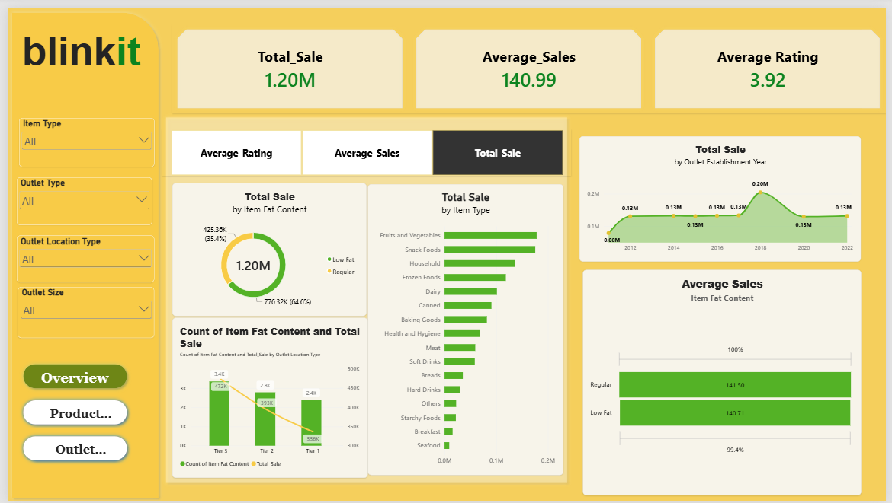
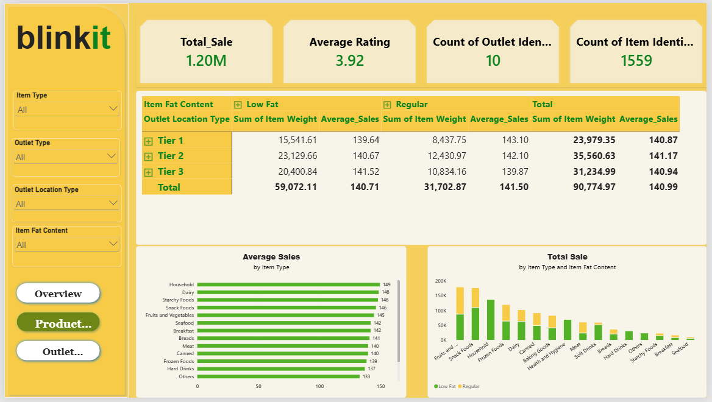
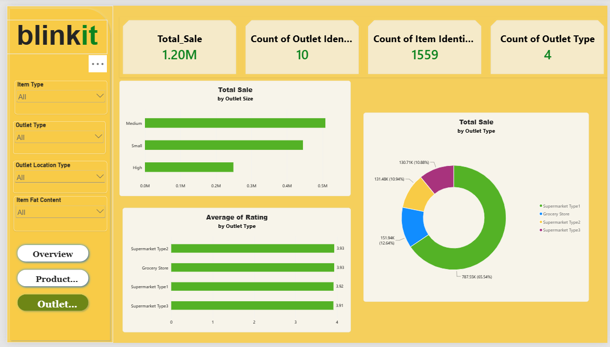

# **Blinkit Sales Dashboard Analysis | Power BI**

## 📊 **Project Overview**

This project focuses on analyzing Blinkit's sales performance using Power BI. The dashboard provides insights into product sales, outlet performance, item fat content, outlet location, and customer ratings.

The main objective is to understand sales trends, identify high-performing product categories, and evaluate outlet performance through interactive dashboard visualizations.

## 🎯 **Project Objectives**

- Analyze overall sales performance.

- Identify top-performing item types.

- Compare sales based on item fat content.

- Analyze sales across different outlet types.

- Understand the impact of outlet size and location on sales.

- Compare average ratings across outlet types.

- Generate meaningful business insights from the dashboard.

## 📁 **Dashboard Pages**

The Power BI dashboard consists of three pages:

### 1. **Overview Dashboard**

Provides an overall summary of Blinkit's sales performance.

### Key Performance Indicators (KPIs):

- Total Sales: 1.20M

- Average Sales: 140.99

- Average Rating: 3.92

### Visualizations:

- Total Sales by Item Fat Content

- Total Sales by Item Type

- Total Sales by Outlet Establishment Year

- Sales and Item Count by Outlet Location Type

- Average Sales by Item Fat Content

### 2. **Product Analysis**

Focuses on product-level sales performance.

### Visualizations:

- Average Sales by Item Type

- Total Sales by Item Type and Item Fat Content

- Comparison of Low Fat and Regular products

- Average Sales comparison across outlet location tiers

### 3. **Outlet Analysis**

Analyzes sales performance based on outlet characteristics.

### Visualizations:

- Total Sales by Outlet Size

- Total Sales by Outlet Type

- Average Rating by Outlet Type

## 📌 **Key Insights**

1. Total Sales: The dashboard displays total sales of approximately 1.20M.

2. Item Fat Content: Low Fat products contribute 776.32K (64.6%) of total sales, while Regular products contribute 425.36K (35.4%).

3. Top Item Types: Fruits and Vegetables and Snack Foods are among the leading item types in total sales.

4. Outlet Performance: Supermarket Type1 contributes the highest sales of 787.55K, representing 65.54% of total sales.

5. Outlet Ratings: Average ratings across outlet types are very similar, ranging from 3.91 to 3.93.

6. Average Sales by Item Type: Household has the highest average sales (149), while Others has the lowest (133).

7. Outlet Location: Average sales are nearly consistent across Tier 1, Tier 2, and Tier 3 locations.

## 🛠️ **Tools & Technologies**

- Power BI Desktop

- Power Query

- DAX (Data Analysis Expressions)

- Microsoft Excel (Data Source / Data Preparation)

## 📈 **Dashboard Features**

- Interactive slicers and filters

- KPI cards for performance monitoring

- Product and outlet-level analysis

- Comparative sales visualizations

- Business insights and performance evaluation

## 💡 **Business Recommendations**

- Focus on understanding the sales contribution of Low Fat products.

- Analyze Supermarket Type1 outlets to identify the factors behind their high sales contribution.

- Compare product performance across different outlet locations.

- Investigate outlet establishment year and sales patterns.

- Monitor product ratings and sales performance to identify improvement opportunities.

## 📂 **Project Files**

| File | Purpose | 
|----------|----------|
| BlinkitDashboard.pbix   | PowerBI project file   | 
| Blinkit_grocery_Dashboard.pptx   | Project presentation   | 
| BlinkitDashboard.pdf   | Exported PowerBI dashboard   | 
| Blinkit Grocery Data.xlsx   | Dataset  | 
| images    |  Dashboard screenshots   | 
| README.md     | Project documentation   | 

## 📷 **Dashboard Preview**

### 1. Dashboard Overview

### 2. KPI Analysis

### 3. Sales Person Performance

## 🏁 **Conclusion**

This Blinkit Sales Dashboard project demonstrates how Power BI can be used to analyze sales performance and generate meaningful business insights.

The dashboard helps understand product-level sales, outlet performance, item fat content contribution, and outlet location patterns. These insights can support better business decisions and performance monitoring.

**Project**: Blinkit Sales Dashboard Analysis
**Tool**: Microsoft Power BI
**Category**: Data Analytics & Business Intelligence

## 👩‍💻 **Author**

[Anjana P C]
